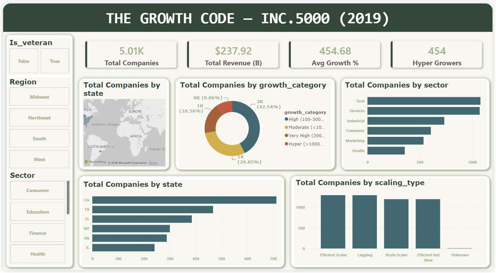
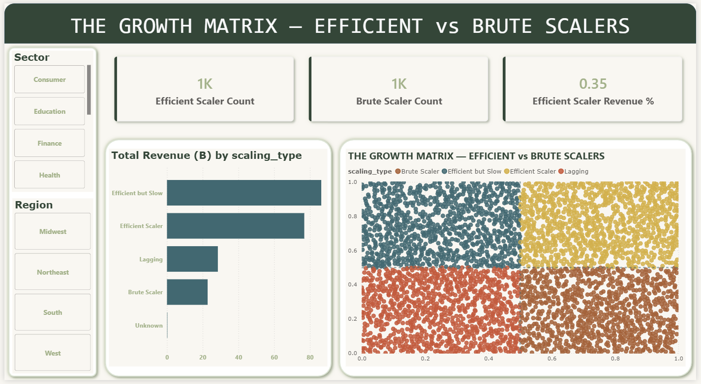
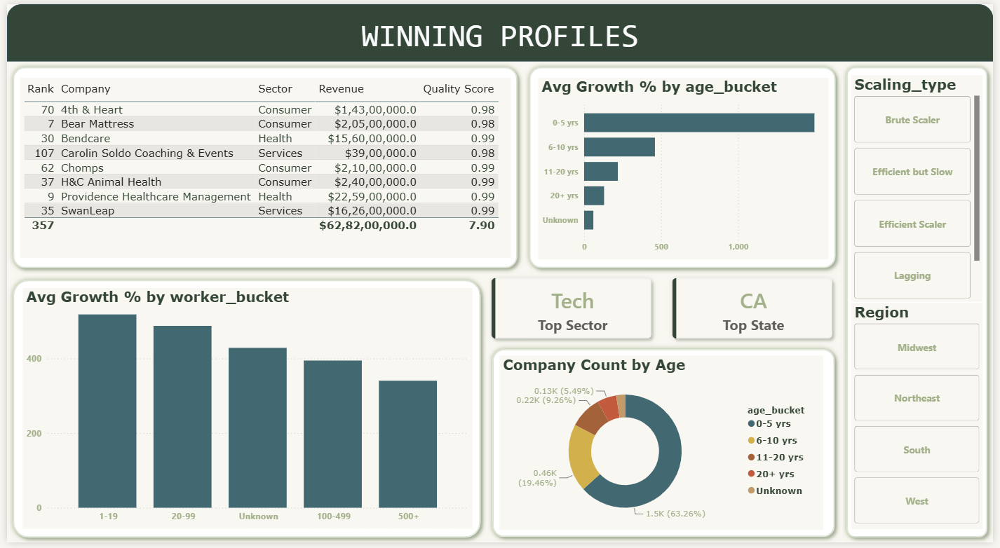

# 📊 The Growth Code: Decoding the Inc. 5000 (2019)

<p align="center">
  <strong>An End-to-End Data Analytics & Business Intelligence Project</strong>
  <br/>
  Turning company growth data into meaningful business insights using Python, MySQL and Power BI.
</p>

<p align="center">
  
  
  
  
</p>

---

## 📌 1. Project Overview

**The Growth Code** is an end-to-end data analytics project that explores the **2019 Inc. 5000 dataset**, featuring America's fastest-growing private companies.

The project goes beyond company rankings to investigate the patterns and characteristics associated with rapid business growth.

Using Python, MySQL and Power BI, I analyzed company revenue, growth percentages, workforce size, industries, geographical distribution and company age to understand how businesses scale.

The analysis focuses on identifying growth patterns, comparing workforce efficiency, examining industry performance and understanding the characteristics of high-growth companies.

**The objective:** Transform raw company data into meaningful insights that can support data-driven business decisions.

## 🎯 2. Business Problem & Objectives

### The Business Problem

A high growth percentage does not necessarily indicate an efficient or sustainable business model.

Some companies may achieve rapid growth through increased workforce expansion, while others may generate strong revenue with relatively smaller teams.

The objective of this analysis is to investigate what differentiates these growth patterns and identify the characteristics associated with high-performing companies.

### Key Business Questions

1. Which industries contribute the most to the Inc. 5000 company list?
2. Which states and geographical regions have the highest concentration of high-growth companies?
3. Is rapid growth associated with workforce expansion or revenue per employee?
4. Do first-time companies on the list grow faster than repeat-listed companies?
5. How does company age relate to growth performance?
6. Which workforce-size categories demonstrate higher average growth?
7. Which companies demonstrate a combination of high growth and high revenue per employee?

## 📂 3. Dataset Information

| Attribute | Details |
|---|---|
| Dataset | Inc. 5000 Companies 2019 |
| Source | Public 2019 Inc. 5000 dataset |
| Records | 5,012 rows |
| Columns | 44 columns after feature engineering |
| Time Period | 2019 |
| Domain | Business & Company Growth Analytics |
| Format | CSV |

### Important Dataset Attributes

- `revenue_usd` – Company revenue converted into numerical USD values.
- `growth_pct` – Company growth percentage.
- `workers` – Current employee count.
- `previous_workers` – Previous employee count.
- `sector` – Business industry or sector.
- `founded` – Company founding year.
- `scaling_type` – Engineered company growth classification.
- `growth_quality_score` – Engineered analytical score.

**Dataset Files:**

- [View Raw Dataset](https://github.com/jerry-221/Inc5000-Growth-Analytics/blob/main/INC%205000%20Companies%202019.csv)
- [View Cleaned Dataset](https://github.com/jerry-221/Inc5000-Growth-Analytics/blob/main/INC_5000_Companies_clean.csv)

## 🛠️ 4. Tools & Technologies

| Technology | Libraries / Concepts | Purpose |
|---|---|---|
| Python | Python 3.10+ | Data preparation and analysis |
| Pandas | DataFrames | Data cleaning and manipulation |
| NumPy | Numerical operations | Numerical calculations and feature engineering |
| Matplotlib | Visualization | Exploratory data visualization |
| Seaborn | Statistical visualization | Identifying patterns and relationships |
| MySQL | MySQL 8.0 | Database management and SQL analysis |
| Power BI | DAX, Interactive Visuals | Dashboard development and business intelligence |

## 🔄 5. Project Workflow

The project follows a structured end-to-end data analytics workflow.

**Step 1 – Data Collection**

Collected the 2019 Inc. 5000 company dataset and inspected its structure, columns and data quality.

**Step 2 – Data Cleaning & Preparation (Python)**

- Inspected missing values and duplicate records.
- Converted text-based revenue values into numerical USD values.
- Corrected data types and handled invalid records.
- Created additional analytical features.
- Prepared the cleaned dataset for SQL analysis.

**Step 3 – Exploratory Data Analysis (Python)**

- Analyzed company growth distributions.
- Examined revenue and workforce patterns.
- Compared industries and geographical regions.
- Investigated relationships between growth and workforce efficiency.

**Step 4 – SQL Business Analysis (MySQL)**

- Imported the cleaned dataset into MySQL.
- Structured the data for analytical querying.
- Developed 30+ business-focused SQL queries.
- Applied advanced SQL techniques to identify business trends.

**Step 5 – Dashboard Development (Power BI)**

- Developed a three-page interactive dashboard.
- Created KPI measures and analytical visuals.
- Designed comparisons between company growth and workforce efficiency.
- Presented findings through interactive visual storytelling.

**Step 6 – Insights & Recommendations**

Converted analytical findings into business observations and recommendations.

## 🐍 6. Python Analysis – Data Cleaning & EDA

Python was used to prepare the raw dataset, handle inconsistencies and perform exploratory data analysis.

### Data Cleaning Challenges & Solutions

**Challenge 1: Revenue Stored as Text**

Revenue values were stored in formats such as `36.9 Million` and `1.2 Billion`, making numerical calculations difficult.

**Solution:** Developed a custom parsing function to convert text-based revenue values into numerical USD values using Pandas.

Created the `revenue_usd` column for accurate numerical analysis.

**Challenge 2: Missing Workers & Invalid Founding Years**

Identified records containing zero or missing worker counts and an invalid founding year.

**Solution:**
- Converted invalid worker values to `NaN`.
- Handled invalid founding years without automatically deleting the entire records.
- Used appropriate unknown or missing-value classifications.
- Prevented division-by-zero issues when calculating revenue per worker.

**Challenge 3: Duplicate Company Rankings**

Identified 12 duplicate ranks in the dataset.

**Solution:** Investigated the duplicate ranks and retained legitimate ranking ties instead of incorrectly removing them. Created an `is_tie_rank` Boolean flag.

### Feature Engineering

Created 30+ additional analytical columns to support deeper business analysis.

One important feature was `scaling_type`, which classifies companies by comparing their growth percentile against their revenue-per-worker percentile.

The four analytical categories are:

- Efficient Scalers
- Brute Scalers
- Efficient but Slow
- Lagging

This classification helps compare growth performance and workforce efficiency.

**Python Notebook:**

[📓 Explore Python Data Cleaning & EDA Notebook](https://github.com/jerry-221/Inc5000-Growth-Analytics/blob/main/INC_5000_Companies_code.ipynb)

## 🗄️ 7. SQL Analysis – MySQL

After cleaning and preparing the dataset in Python, I imported it into a MySQL database named `inc5000_analytics`.

Developed **30+ SQL queries** to investigate company growth, revenue distribution, industry performance and workforce patterns.

### SQL Challenges & Solutions

**Challenge 1: Reserved Keywords and Special Characters**

Some original column names created SQL compatibility issues.

- `rank` was renamed to `company_rank`.
- `growth_%` was renamed to `growth_pct`.

**Solution:** Used `ALTER TABLE` to rename the columns and make them easier to query.

### SQL Concepts Applied

| SQL Concept | Application |
|---|---|
| SELECT & WHERE | Filtering company records |
| GROUP BY | Industry and regional analysis |
| Aggregate Functions | Revenue, employee and growth calculations |
| JOINs | Combining related datasets |
| CTEs | Structuring complex analytical queries |
| Subqueries | Nested business analysis |
| Window Functions | Ranking and comparative analysis |
| NTILE() | Dividing companies into performance groups |
| ROW_NUMBER() | Ranking companies within industries |
| CASE WHEN | Conditional business classification |
| Conditional Aggregation | Comparing multiple business categories |

### Example Business Analysis

- Identifying top-performing companies within each industry.
- Comparing revenue across geographical regions.
- Analyzing the Pareto distribution of company revenue.
- Identifying top 10% growth performers.
- Comparing first-time and repeat-listed companies.

**SQL File:**

[🗄️ Explore SQL Business Analysis Queries](https://github.com/jerry-221/Inc5000-Growth-Analytics/blob/main/Queries.sql)

## 📊 8. Power BI Dashboard

Developed a **three-page interactive Power BI dashboard** to present the findings through executive-level reporting and business storytelling.

### Dashboard Preview

#### Page 1 – Executive Summary



**Focus Areas:**
- Overall company performance.
- Total revenue and workforce KPIs.
- Geographical distribution of companies.
- Industry and sector performance.
- High-level business overview.

[View Page 1 Screenshot](https://github.com/jerry-221/Inc5000-Growth-Analytics/blob/main/Dashboard_screenshots/Page_1_2026-11-11%20220148.png)

#### Page 2 – The Growth Matrix



**Focus Areas:**
- Growth percentile vs. revenue-per-worker percentile.
- Comparison of efficient and brute scalers.
- Growth performance distribution.
- Identification of different company scaling patterns.

[View Page 2 Screenshot](https://github.com/jerry-221/Inc5000-Growth-Analytics/blob/main/Dashboard_screenshots/Page_2_%202026-11-11%20220221.png)

#### Page 3 – Winning Profiles



**Focus Areas:**
- Top 20 companies by growth quality score.
- Top-performing sectors and states.
- Company age and workforce-size analysis.
- Comparative company performance.

[View Page 3 Screenshot](https://github.com/jerry-221/Inc5000-Growth-Analytics/blob/main/Dashboard_screenshots/Page_3_2026-11-11%20220255.png)

### Power BI Project File

[📈 Download / View Interactive Power BI Dashboard (.pbix)](https://github.com/jerry-221/Inc5000-Growth-Analytics/blob/main/The_Growth_Code.pbix)

*Note: Open the PBIX file using Power BI Desktop. Database connection configuration may be required.*

## 💡 9. Key Insights & Findings

The analysis revealed several interesting patterns across the 2019 Inc. 5000 companies.

**1. First-Time Companies Outperform Repeat Listers**

First-time companies demonstrated an average growth rate of approximately 754%, compared with 279% for repeat-listed companies — around 2.7 times higher.

**2. Efficient Scalers Generate Significant Revenue**

Efficient Scalers represent approximately 26% of the companies but contribute around 35% of the total $237.9 billion revenue.

**3. Geographical Concentration of Growth**

California, Texas and Florida collectively account for approximately 31% of the companies on the list.

**4. Smaller Teams Demonstrate Higher Average Growth**

Companies with 1–19 employees showed the highest average growth rate among workforce-size categories, indicating an interesting relationship between company size and growth performance.

## 🚀 10. Business Recommendations

Based on the findings, the following recommendations can support business decision-making.

**For Investors**

- Investigate companies demonstrating both high growth and high revenue per employee.
- Evaluate workforce efficiency alongside growth performance.
- Consider industry and geographical trends when identifying potential investment opportunities.

**For Entrepreneurs & Business Owners**

- Focus on operational efficiency rather than workforce expansion alone.
- Monitor revenue per employee as an indicator of workforce productivity.
- Study high-performing companies within the same industry.
- Evaluate growth performance alongside company age and team size.

*Note: Revenue per employee is used as an efficiency indicator in this project. It should not be interpreted as actual profitability.*

## 📁 11. Repository Structure

```text
Inc5000-Growth-Analytics/
│
├── README.md
│
├── INC 5000 Companies 2019.csv
│
├── INC_5000_Companies_clean.csv
│
├── INC_5000_Companies_code.ipynb
│
├── Queries.sql
│
├── The_Growth_Code.pbix
│
└── Dashboard_screenshots/
    ├── Page_1_2026-11-11 220148.png
    ├── Page_2_ 2026-11-11 220221.png
    └── Page_3_2026-11-11 220255.png
```

## 💻 12. How to Run This Project

Follow these steps to explore and reproduce the analysis.

### Prerequisites

- Python 3.10 or later
- Jupyter Notebook
- MySQL 8.0
- Power BI Desktop

### Step 1 – Clone the Repository

```bash
git clone https://github.com/jerry-221/Inc5000-Growth-Analytics.git

cd Inc5000-Growth-Analytics
```

### Step 2 – Install Python Libraries

```bash
pip install pandas numpy matplotlib seaborn jupyter
```

### Step 3 – Run Python Analysis

Open the notebook:

```bash
jupyter notebook INC_5000_Companies_code.ipynb
```

Run the notebook cells to explore the data-cleaning, feature-engineering and EDA process.

### Step 4 – Perform SQL Analysis

1. Open MySQL Workbench or another MySQL client.
2. Create the database `inc5000_analytics`.
3. Import the cleaned CSV file into a MySQL table.
4. Execute the queries in `Queries.sql`.

### Step 5 – Explore the Power BI Dashboard

1. Open `The_Growth_Code.pbix` in Power BI Desktop.
2. Configure the required data source connection if prompted.
3. Refresh the dataset if necessary.
4. Explore the three interactive dashboard pages.

## 🏁 13. Conclusion & Future Improvements

This project demonstrates an end-to-end data analytics workflow, from raw data preparation and exploratory analysis to advanced SQL querying and interactive Power BI visualization.

The analysis highlights how growth percentages, workforce size, revenue per employee, industry and geography can reveal different patterns in business scaling.

### Future Improvements

- Incorporate multi-year Inc. 5000 datasets to analyze company growth trends over time.
- Compare company performance across different economic periods.
- Introduce predictive analytics to investigate future company growth patterns.
- Explore additional business performance indicators where data is available.

## 👨‍💻 14. Author & Contact

**Pranav Patil**

Aspiring Data Analyst | Python | SQL | Power BI

Interested in data analytics, business intelligence and transforming raw data into meaningful business insights.

- **GitHub:** [Explore My Projects](https://github.com/jerry-221)
- **LinkedIn:** [Connect with Me](YOUR_LINKEDIN_PROFILE_URL)
- **Email:** YOUR_EMAIL_ADDRESS

---

<p align="center">
  <strong>⭐ If you find this project interesting, consider giving the repository a star!</strong>
  <br/>
  <sub>Thank you for exploring The Growth Code.</sub>
</p>
